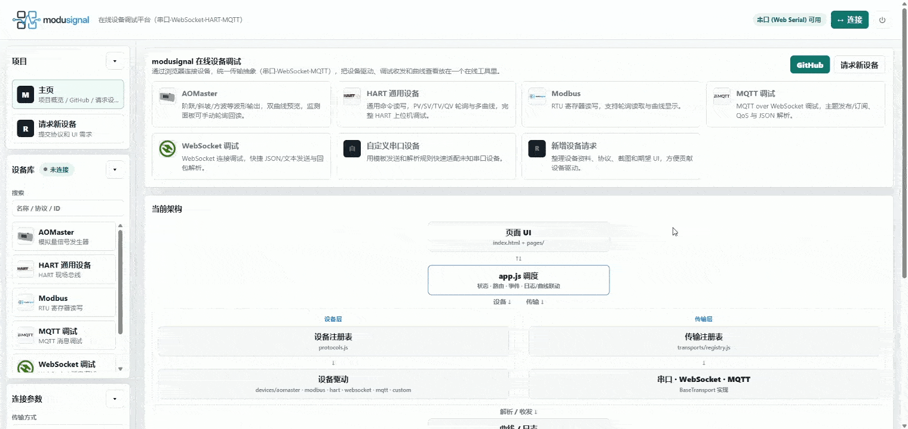
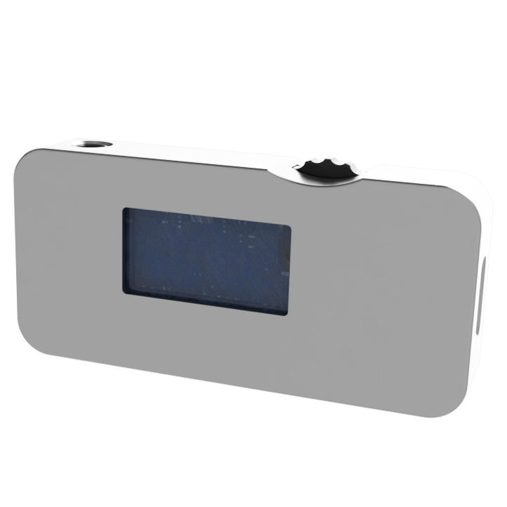

<p align="center">
  
  <h1 align="center">modusignal</h1>
  <p align="center">A browser device debugger and visual HMI workspace for hardware engineers</p>
  <p align="center">English · <a href="README_zh.md">简体中文</a> · <a href="https://modusignal.cn/">Open the app</a> · <a href="CONTRIBUTING.md">Contributing</a></p>
</p>

modusignal is the browser workspace in the hardware tool family alongside [FluentHMI Studio](https://github.com/txp666/FluentHMI-Studio) and [PyQt UI Designer](https://github.com/txp666/PyQt-UI-Designer). Its static HTML/JavaScript app connects to serial, WebUSB, WebSocket and MQTT-over-WebSocket devices, shows traffic and live values, and provides a Custom Device canvas for the supported subset of shared `.uidp` projects. Open it in a browser; no desktop installation is required.

> **Language**: English and Simplified Chinese are available in the app. Device access depends on the browser and transport; see [Browser support](#browser-support).

## Screenshots

<p align="center">
  
</p>

<table>
  <tr>
    <td width="25%" align="center">
      <br/>
      <sub><b>AOMaster</b><br/>4-20 mA / 0-10 V<br/>6 waveforms</sub>
    </td>
    <td width="25%" align="center">
      <br/>
      <sub><b>HART</b><br/>Field instrument debugging<br/>PV / SV / TV / QV</sub>
    </td>
    <td width="25%" align="center">
      <br/>
      <sub><b>WebSocket</b><br/>JSON / HEX / Modbus<br/>Live chart</sub>
    </td>
    <td width="25%" align="center">
      <br/>
      <sub><b>MQTT</b><br/>Pub / sub · QoS<br/>Retain · stats</sub>
    </td>
  </tr>
</table>

## What it is

A static web app for debugging devices from a browser. No installer, no backend. Open the page, pick a device, connect, and you get raw frames, manual send, parsed values and a real-time chart.

> Open a tab. Plug in a device. Talk to it.

**Use cases**

- Bench-test a Modbus RTU board without a several-hundred-MB vendor tool
- Plug a HART modem into a laptop on site and you have a HART debugger
- Bring up a WebSocket or MQTT device and watch its traffic on a live chart
- Hand a colleague a URL instead of a `setup.exe`
- Build a control panel for an in-house protocol by dragging widgets onto the *Custom device* canvas, no code required

Not for long-running data acquisition, plant monitoring or SCADA; it is a debugging tool.

For a Modbus switch on the Custom Device canvas, choose a coil (default, FC05) or a holding register (FC06: ON writes `1`, OFF writes `0`). Bind its state to a holding register. In the switch properties, choose an ON condition: Nonzero is ON (default), or Equals comparison value and enter the value (default `1`). This rule applies to received state; register commands still write 1/0. These settings are shared with FluentHMI Studio and PyQt UI Designer `.uidp` projects.

## Built-in devices

| Device | Transport | Default | Notes |
|--------|-----------|---------|-------|
| Modbus RTU | Serial | 9600 8N1 | Read / write holding and input registers |
| HART | Serial | 1200 8O1 | Device search, universal commands, PV/SV/TV/QV, instrument settings and calibration |
| WebSocket | WebSocket | — | JSON / HEX / Modbus message debugging |
| MQTT | MQTT over WS | — | Pub / sub, QoS, retain, message stats |
| AOMaster | Serial | 115200 8N1 | 4-20 mA / 0-10 V signal source |
| MicroScope Power | WebUSB | — | Low-current waveform capture ([hardware](https://oshwhub.com/txp666/project_iupheygc) · [firmware](https://github.com/txp666/MicroScope-Power)) |
| Custom | Serial / WebSocket / MQTT (link cards on the canvas) | — | Drag-and-drop canvas; widgets bind to the protocol and send commands; `.uidp` projects |

Switching devices also switches the transport and its defaults.

## Features

- **Transceiver log**: millisecond timestamps, HEX / text view, pause scroll, RX / TX byte counts, save as .txt.
- **Modbus RTU**: request/response exchanges with timeout and exception diagnostics; a register table in 16 / 32-bit integer, Float32 and other formats.
- **HART**: address scan, universal commands, PV/SV/TV/QV polling, instrument settings and I/O calibration; response timeout and response-code diagnostics, with confirmation before writes.
- **Custom device**: a drag-and-drop canvas like [FluentHMI Studio](https://github.com/txp666/FluentHMI-Studio). Buttons, switches, sliders, numeric displays, gauges, LEDs, live charts and more take their values by key, JSON path, HEX bytes or Modbus register (with an optional expression) and send text, HEX, JSON or Modbus commands. Serial, TCP (through WebSocket) and MQTT link cards are configured and connected on the canvas, several at once, and Modbus bindings are polled automatically; receiving, sending and the log are cards too. Projects are `.uidp` files that open in FluentHMI Studio / PyQt UI Designer, and their projects import.

  For AI-generated browser projects, use Web Serial for serial (Chrome/Edge, HTTPS or localhost), a WebSocket gateway endpoint for TCP, and the broker’s WebSocket endpoint for MQTT. Use WSS on HTTPS pages. Find the format and templates in the shared [`.uidp` AI entry point](https://raw.githubusercontent.com/txp666/FluentHMI-Studio/main/docs/uidp-format.md).

  The Industrial Instruments (12 widgets) and Industrial Equipment (25 widgets) groups include pressure, flow, level, pumps, valves, conveyors, and electrical devices. The original [industrial feedback replay project](examples/industrial/工业控件回放.uidp) covers 36 of them. The full gallery also demonstrates the three-position directional valve.

  Automotive electronics provides 13 read-only feedback widgets, Electronics DIY 14, and Embedded systems 14. Open the [electronics replay project](examples/industrial/电子控件回放.uidp) and use `replay.py --frames 电子反馈.jsonl --web` with the electronics frames. See the [widget types and properties](https://raw.githubusercontent.com/txp666/FluentHMI-Studio/main/docs/uidp/electronics.md).

  Run `npm run build` and `npm run preview` to open the local gallery. Select a frame to inspect motion, faults, bit patterns, and recovery, or download the same project for desktop use. The Signals and Diagnostics tab pairs a status word with its timing trace and displays encoder, battery, power supply, and valve feedback. [Local dynamic widget gallery](http://127.0.0.1:4173/examples/industrial/) · [Signals and Diagnostics](http://127.0.0.1:4173/examples/industrial/?page=%E4%BF%A1%E5%8F%B7%E4%B8%8E%E8%AF%8A%E6%96%AD)
- **Live chart**: multiple series, CSV import and export.
- **Also**: Chinese and English UI, light and dark themes.

## Desktop software

The "Desktop software" section of the home page introduces these apps; each has its own site:

| App | Site |
|-----|------|
| HARTLink Studio · HART master and DD device commissioning | <https://hart.modusignal.cn/> (with the [HART wiki](https://hart.modusignal.cn/wiki/)) |
| Fluent Serial Assistant · serial debugging, protocol parsing and AI control | <https://serial.modusignal.cn/> |
| FluentHMI Studio · drag-and-drop HMIs (with the Python edition, PyQt UI Designer) | <https://hmi.modusignal.cn/> |
| PageBridge · PDF reading and translation in the original layout | <https://pagebridge.modusignal.cn/> |

The product pages, tutorials and HART wiki that used to live here moved to those sites; `_redirects` sends the old addresses there.

## Quick start

No build is needed for development; serve the repo as static files:

```bash
python3 -m http.server 4173
```

Open `http://localhost:4173` in Chrome or Edge.

To build the site:

```bash
npm install
npm run build
npm run preview
```

The build script is `scripts/build.mjs` (esbuild); output goes to `_site/`. The site runs on Cloudflare Workers (`wrangler.jsonc`): build, then `npx wrangler deploy`. This repository has no Releases.

## Browser support

| Feature | Browsers |
|---------|----------|
| Serial (Web Serial) | Chrome / Edge 89+, HTTPS or localhost |
| WebUSB | Chrome / Edge, HTTPS or localhost |
| WebSocket, MQTT over WebSocket | any modern browser |

Firefox and Safari don't support Web Serial or WebUSB, so serial and WebUSB devices won't work there; everything else does.

## Development

Devices and transports are kept separate. Adding a device is usually a driver in `src/devices/`, an entry in `src/device-registry.js` and a page in `pages/devices/`.

- [`CONTRIBUTING.md`](./CONTRIBUTING.md): steps for adding a device (in Chinese)
- [`docs/architecture.md`](./docs/architecture.md): module layers
- [`DESIGN.md`](./DESIGN.md): UI design guidelines
- [`AI.md`](./AI.md): per-device protocol contracts and implementation notes (in Chinese)

Tests: `npm test`.

`workers/cos-download-proxy/` is `download.modusignal.cn`, the download proxy for HARTLink Studio packages and update manifests; it is deployed on its own.

## Get involved

modusignal is actively developed. If you need a device supported but don't want to write the driver, [open a request](https://github.com/txp666/modusignal/issues/new?title=%E6%96%B0%E8%AE%BE%E5%A4%87%E6%94%AF%E6%8C%81%E8%AF%B7%E6%B1%82) with the protocol document, sample frames and default connection parameters. PRs that add devices or fix drivers are welcome.

## Related projects

| Project | Role |
| --- | --- |
| [FluentHMI Studio](https://github.com/txp666/FluentHMI-Studio) | Native C++/Qt 6 HMI designer with standalone runtime export |
| [PyQt UI Designer](https://github.com/txp666/PyQt-UI-Designer) | Python/PyQt5 HMI designer with editable Python source export and Nuitka packaging |
| [modusignal](https://github.com/txp666/modusignal) | Browser device debugger and `.uidp` Custom Device editor, within browser transport limits |
| [FluentPLC Simulator](https://github.com/txp666/FluentPLC-Simulator) | Independent desktop and CLI classic S7comm server for testing S7 clients |

The HMI tools share `.uidp` projects where their widgets and transports are supported. FluentPLC Simulator uses its own `.plcsim.json` format. S7 client support is not currently implemented in FluentHMI Studio, PyQt UI Designer or modusignal.

## License

[Apache License 2.0](./LICENSE.txt).

If modusignal saved you an afternoon of fighting with a vendor installer, a star helps other people find it.

---

<p align="center">
  <sub>by <a href="https://space.bilibili.com/509795217">飞起小鹏</a> · <a href="https://modusignal.cn/">modusignal.cn</a></sub>
</p>
