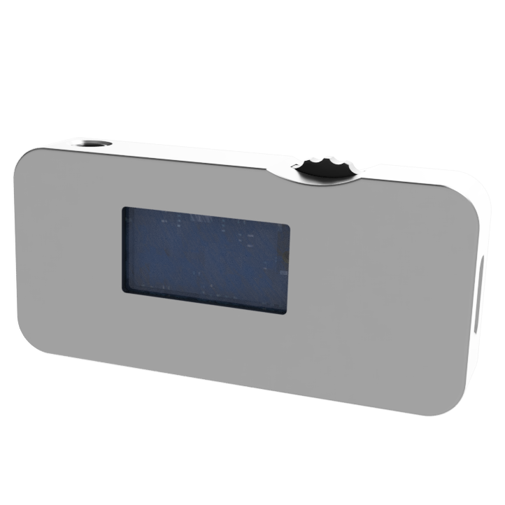

<p align="center">
  
</p>

<p align="center">
  <b>Talk to industrial devices from a browser tab.</b><br/>
  <sub>Serial · WebUSB · WebSocket · MQTT · Modbus RTU · HART · custom protocols</sub>
</p>

<p align="center">
  <a href="https://modusignal.cn/"></a>
  <a href="./LICENSE.txt"></a>
  <a href="https://github.com/txp666/modusignal/stargazers"></a>
  <a href="https://github.com/txp666/modusignal/issues"></a>
  <a href="https://github.com/txp666/modusignal/commits"></a>
</p>

<p align="center">
  <a href="./README.md">中文</a> ·
  <b>English</b> ·
  <a href="https://modusignal.cn/">Open the app →</a> ·
  <a href="https://github.com/txp666/modusignal/issues/new?title=%E6%96%B0%E8%AE%BE%E5%A4%87%E6%94%AF%E6%8C%81%E8%AF%B7%E6%B1%82">Request a device</a>
</p>

<p align="center">
  
</p>

<table>
  <tr>
    <td width="25%" align="center">
      <br/>
      <sub><b>AOMaster</b><br/>4-20 mA / 0-10 V<br/>6 waveforms</sub>
    </td>
    <td width="25%" align="center">
      <br/>
      <sub><b>HART</b><br/>Field instrument debugging<br/>PV / SV / TV / QV</sub>
    </td>
    <td width="25%" align="center">
      <br/>
      <sub><b>WebSocket</b><br/>JSON / HEX / Modbus<br/>Live chart</sub>
    </td>
    <td width="25%" align="center">
      <br/>
      <sub><b>MQTT</b><br/>Pub / sub · QoS<br/>Retain · stats</sub>
    </td>
  </tr>
</table>

## What it is

A static web app for debugging devices from a browser. No installer, no backend. Open the page, pick a device, connect, and you get raw frames, manual send, parsed values and a real-time chart.

> Open a tab. Plug in a device. Talk to it.

**Use cases**

- Bench-test a Modbus RTU board without a several-hundred-MB vendor tool
- Plug a HART modem into a laptop on site and you have a HART debugger
- Bring up a WebSocket or MQTT device and watch its traffic on a live chart
- Hand a colleague a URL instead of a `setup.exe`
- Build a quick UI for an in-house protocol on the *Custom device* page, no code required

Not for long-running data acquisition, plant monitoring or SCADA; it is a debugging tool.

## Built-in devices

| Device | Transport | Default | Notes |
|--------|-----------|---------|-------|
| Modbus RTU | Serial | 9600 8N1 | Read / write holding and input registers |
| HART | Serial | 1200 8O1 | Device search, universal commands, PV/SV/TV/QV, instrument settings and calibration |
| WebSocket | WebSocket | — | JSON / HEX / Modbus message debugging |
| MQTT | MQTT over WS | — | Pub / sub, QoS, retain, message stats |
| AOMaster | Serial | 115200 8N1 | 4-20 mA / 0-10 V signal source |
| MicroScope Power | WebUSB | — | Low-current waveform capture ([hardware](https://oshwhub.com/txp666/project_iupheygc) · [firmware](https://github.com/txp666/MicroScope-Power)) |
| Custom | any | — | Send template + parser, no code |

Switching devices also switches the transport and its defaults.

## Features

- **Transceiver log**: millisecond timestamps, HEX / text view, pause scroll, RX / TX byte counts, save as .txt.
- **Modbus RTU**: request/response exchanges with timeout and exception diagnostics; a register table in 16 / 32-bit integer, Float32 and other formats.
- **HART**: address scan, universal commands, PV/SV/TV/QV polling, instrument settings and I/O calibration; response timeout and response-code diagnostics, with confirmation before writes.
- **Custom device**: a saved command library (import / export, timed sending), text escapes, CRC16 / SUM8 / XOR8; send templates with `{value}` placeholders and parsers for regex, JSON path, HEX offset and Modbus payloads.
- **Live chart**: multiple series, CSV import and export.
- **Also**: Chinese and English UI, light and dark themes, and an offline package.

## Quick start

No build is needed for development; serve the repo as static files:

```bash
python3 -m http.server 4173
```

Open `http://localhost:4173` in Chrome or Edge.

To build a release:

```bash
npm install
npm run build
npm run preview
```

The build script is `scripts/build.mjs` (esbuild); output goes to `_site/`.

## Offline package

For a self-contained copy on a laptop or plant PC, with no network needed.

- **Download**: after each push to `main`, get `modusignal-offline-<version>.zip` from the latest run in [Actions → Offline package](https://github.com/txp666/modusignal/actions/workflows/offline-package.yml); tagged `v*` releases are on [Releases](https://github.com/txp666/modusignal/releases).
- **Run**: unzip, then double-click `start-modusignal.bat` (Windows) or run `start-modusignal.sh` (macOS / Linux). It starts a local server and opens the browser.
- **Build it yourself**: `npm install`, then `npm run build:offline`; output goes to `_release/`.

## Browser support

| Feature | Browsers |
|---------|----------|
| Serial (Web Serial) | Chrome / Edge 89+, HTTPS or localhost |
| WebUSB | Chrome / Edge, HTTPS or localhost |
| WebSocket, MQTT over WebSocket | any modern browser |

Firefox and Safari don't support Web Serial or WebUSB, so serial and WebUSB devices won't work there; everything else does.

## Development

Devices and transports are kept separate. Adding a device is usually a driver in `src/devices/`, an entry in `src/device-registry.js` and a page in `pages/devices/`.

- [`CONTRIBUTING.md`](./CONTRIBUTING.md): steps for adding a device (in Chinese)
- [`docs/architecture.md`](./docs/architecture.md): module layers
- [`DESIGN.md`](./DESIGN.md): UI design guidelines
- [`AI.md`](./AI.md): per-device protocol contracts and implementation notes (in Chinese)

Tests: `npm test`.

## Get involved

modusignal is actively developed. If you need a device supported but don't want to write the driver, [open a request](https://github.com/txp666/modusignal/issues/new?title=%E6%96%B0%E8%AE%BE%E5%A4%87%E6%94%AF%E6%8C%81%E8%AF%B7%E6%B1%82) with the protocol document, sample frames and default connection parameters. PRs that add devices or fix drivers are welcome.

## License

[Apache License 2.0](./LICENSE.txt).

If modusignal saved you an afternoon of fighting with a vendor installer, a star helps other people find it.

---

<p align="center">
  <sub>by <a href="https://space.bilibili.com/509795217">飞起小鹏</a> · <a href="https://modusignal.cn/">modusignal.cn</a></sub>
</p>
